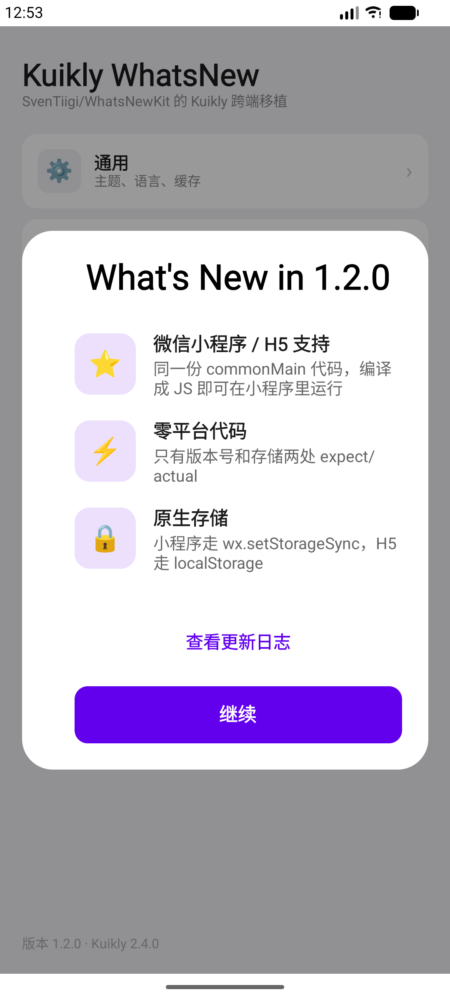
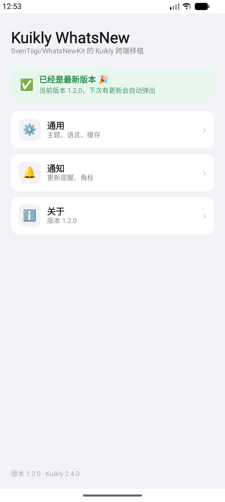
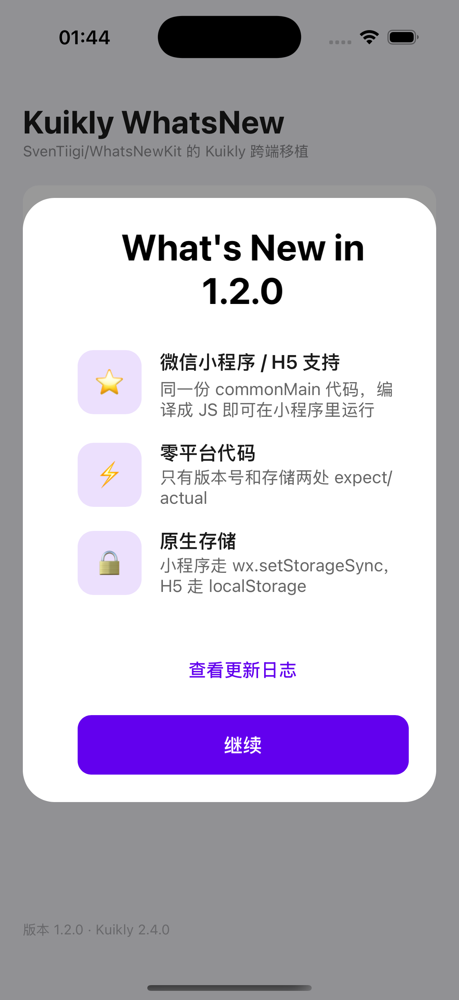
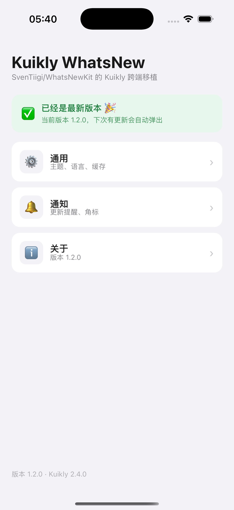
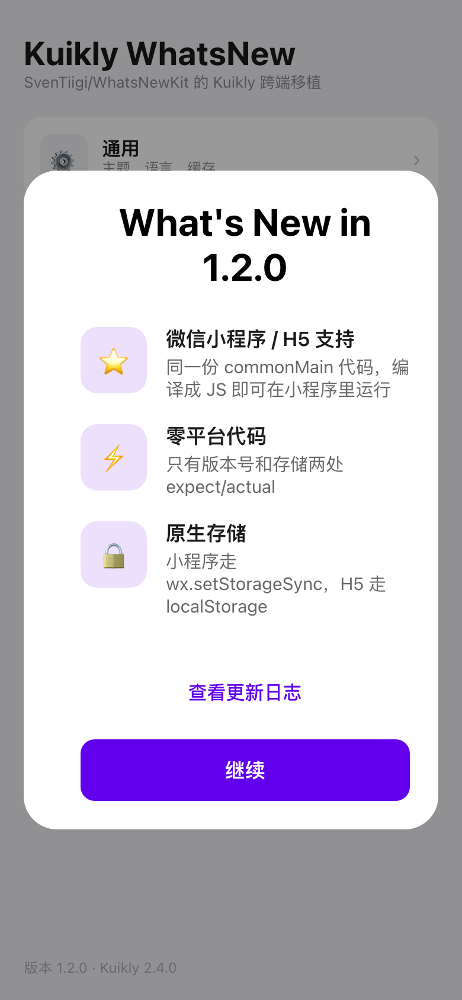
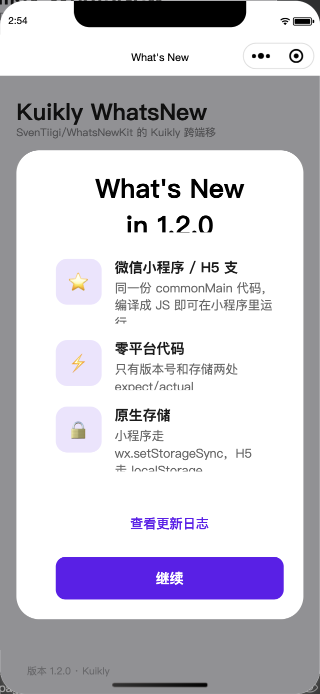
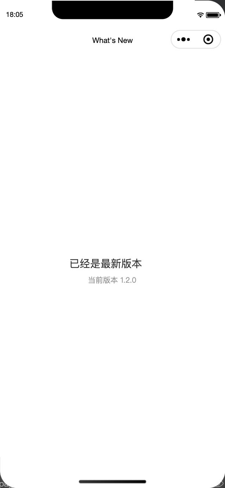

# Kuikly WhatsNewKit

[](https://kotlinlang.org)
[](https://kuikly.tds.qq.com)
[](LICENSE)
[](https://kuikly.tds.qq.com)

> 🎊 基于 Kuikly 跨端框架的 WhatsNewKit 实现，让你的新功能展示跨所有平台！

A fully cross-platform implementation of [WhatsNewKit](https://github.com/SvenTiigi/WhatsNewKit) built on [Kuikly](https://kuikly.tds.qq.com) — Tencent's high-performance, full-platform development framework. Showcase your awesome new app features across **Android, iOS, HarmonyOS, Web, and Mini Programs** with a single codebase.

Inspired by [SvenTiigi/WhatsNewKit](https://github.com/SvenTiigi/WhatsNewKit) — the popular Swift Package for presenting app changelogs.

---

## 📸 运行截图

所有截图都是 **Kuikly 真实渲染**出来的画面（不是原生 View 仿写、也不是设计稿）。
首屏都是「宿主 App 界面 + 盖在上面的 What's New 弹层」：40% 黑遮罩 + 居中圆角卡片，
对应 WhatsNewKit 的 `present(whatsNewViewController)`；点「继续」后弹层消失，宿主界面顶部
显示「已经是最新版本」。
所有端渲染的都是同一份 `:whatsnew` commonMain 组件代码：

- Android / H5 / 微信小程序 跑 [`miniApp/src/commonMain`](miniApp/src/commonMain/kotlin/io/github/Richard102257/whatsnew/demo/WhatsNewDemoPage.kt) 里的页面（H5 是把这份代码编译成 JS 后放进 Kuikly 官方 `h5App-js` 壳；小程序是同一份 JS bundle 放进 Kuikly 官方 `miniApp` 壳）
- iOS 跑 [`shared/src/iosMain`](shared/src/iosMain/kotlin/io/github/Richard102257/whatsnew/shared/WhatsNewIosDemoPage.kt) 里的页面，编译成 Kotlin/Native `shared.framework`

### Android（模拟器，Kuikly `2.4.0-2.0.21`）

| 首次启动：展示 What's New | 点「继续」后再次启动：已是最新版本 |
|---|---|
|  |  |

### iOS（iPhone 16 Pro 模拟器，iOS 18.3）

| 首次启动：展示 What's New | 点「继续」后再次启动：已是最新版本 |
|---|---|
|  |  |

iOS 侧是官方 `OpenKuiklyIOSRender` 渲染器 + Kotlin/Native framework，版本号直接读
`CFBundleShortVersionString`（Info.plist 里是 `1.2.0`），存储走 `NSUserDefaults`。
宿主界面用 Kuikly 的 `SafeArea` 避开灵动岛和底部横条，弹层放在 `SafeArea` 外面（否则遮罩
盖不到状态栏）；其余布局与 Android / H5 完全一致。

### H5（Chromium，`core-render-web` 渲染器）

| 首次启动：展示 What's New | 点「继续」后刷新：已是最新版本 |
|---|---|
|  |  |

H5 这一套不是「一键跑起来」的：`core-render-web` 没有发布到 Maven / npm，渲染器要从
KuiklyUI 源码构建，另外 Kotlin/JS 2.0.21 有个导出 bug 需要在本地壳里绕过。
完整命令和两处本地补丁见 [docs/VERIFICATION.md](docs/VERIFICATION.md#34-h5-真实渲染截图)。

### 微信小程序（微信开发者工具，iPhone 12/13 Pro 模拟器）

| 首次启动：展示 What's New | 点「继续」后重新进入：已是最新版本 |
|---|---|
|  |  |

小程序跑的是和 H5 完全相同的 `nativevue2.js`（同一份 commonMain 编出来的 JS），
只是把渲染器换成了 Kuikly 官方的 `core-render-web:miniapp`，壳用官方 `miniApp` 的
`app.js` / `base.wxml` / `comp.*`。页面顶部的 `What's New` 是微信原生导航栏，
内容区由 Kuikly 渲染；截图里的胶囊按钮、状态栏、Home Indicator 都是开发者工具真实模拟的。

截图对应的行为链路（四端一致）：首屏由 `WhatsNewEnvironment.whatsNew()` 按版本号匹配 →
把 `WhatsNewOverlay`（遮罩 + 居中卡片）盖在宿主界面上 → 点击卡片里的主按钮写入本地存储
（Android `SharedPreferences` / iOS `NSUserDefaults` / H5 `localStorage` / 小程序 `wx.setStorageSync`）→
重启 / 刷新 / 重新进入后 `whatsNew()` 返回 `null`，弹层不再出现，宿主界面顶部显示「已经是最新版本」。
也就是说这些图同时验证了**弹层渲染**和**版本持久化**。

> iOS 的「点继续」不是手工点的：`iosApp/iosAppUITests` 里的 UI 测试用归一化坐标真点了一下
> 卡片上的主按钮，然后再重启 App 截图。命令见
> [docs/VERIFICATION.md](docs/VERIFICATION.md#35-ios-真实渲染截图)。

小程序侧还要额外编一个 `:miniApp` 渲染入口（官方壳要的 `renderView` / `initApp` /
`fontLoaded` 都在这个模块里，`core-render-web:miniapp` 本身只导出 `kotlin` / `com`），
再用开发者工具的「测试号」打开工程。完整步骤见
[docs/VERIFICATION.md](docs/VERIFICATION.md#36-微信小程序真实渲染截图)。

### 各端截图状态（如实说明）

| 平台 | 截图 | 说明 |
|------|------|------|
| Android | ✅ 已覆盖 | 上面的两张，AVD `Medium_Phone_API_37.0` + Kuikly `2.4.0-2.0.21` |
| iOS | ✅ 已覆盖 | 上面的两张，iPhone 16 Pro 模拟器（iOS 18.3）+ Kotlin/Native `shared.framework` + `OpenKuiklyIOSRender`，第二张由 UI 测试真实点击后重启截取 |
| HarmonyOS | ⏳ 未覆盖 | 需要 DevEco Studio + OHOS SDK，`core-render-ohos` 也没有公开 Maven 产物 |
| H5 | ✅ 已覆盖 | 上面的两张，Chromium + `core-render-web`（源码构建）+ 官方 `h5App-js` 壳 |
| 微信小程序 | ✅ 已覆盖 | 上面的两张，微信开发者工具 + `core-render-web:miniapp`（源码构建）+ 官方 `miniApp` 壳，测试号 AppID |

> 没有截图的平台不是「没实现」，而是**当前环境跑不起来**。库的 commonMain 代码是
> 同一份，Android / iOS / H5 / 小程序都跑通意味着逻辑层是通的；鸿蒙的容器差异这里不假装验证过。

---

## 📦 安装

### 单一依赖（Android，推荐）

库是**纯 Kuikly DSL 组件**（`componentType: KuiklyView`），只有一个模块 `:whatsnew`，
不需要任何平台侧原生代码。

```kotlin
// settings.gradle.kts
dependencyResolutionManagement {
    repositories {
        google()
        mavenCentral()
        maven { url = uri("https://jitpack.io") }
    }
}

// build.gradle.kts
kotlin {
    sourceSets {
        val commonMain by getting {
            dependencies {
                implementation("com.github.Richard102257.kuikly-whatsnew-kit:whatsnew:1.3.0")
            }
        }
    }
}
```

> JitPack 在 Linux 上构建，能产出 **Android AAR + JS klib + 公共元数据**。
> Kotlin/Native 的 iOS klib 必须在 macOS 上编译，所以 iOS 走下面两种方式之一。
>
> ⚠️ 1.2.0 起默认依赖 Kuikly `2.4.0-2.0.21`（js 产物从这个版本开始有）。
> 如果你的工程还在 `2.1.x`，升级前请先确认其它依赖兼容。

### iOS

**方式 A：源码模块（推荐，与 Kuikly 官方示例一致）**

```kotlin
// settings.gradle.kts
include(":whatsnew")
project(":whatsnew").projectDir = file("../kuikly-whatsnew-kit/whatsnew")
```

在 macOS 上构建时 iOS target 自动注册，klib 随 App 一起编译。

**方式 B：CocoaPods（已发布到 trunk）**

```ruby
# Podfile
pod 'KuiklyWhatsNew', '~> 1.3.0'
```

[](https://cocoapods.org/pods/KuiklyWhatsNew)

podspec 指向 GitHub Release 上的 `WhatsNew.xcframework.zip`（`ios-arm64` +
`ios-arm64_x86_64-simulator`，静态 framework），由 macOS 上的
`./gradlew :whatsnew:assembleWhatsNewReleaseXCFramework` 构建后上传。
framework 名仍是 `WhatsNew`，pod 名因为 trunk 上 `WhatsNew` 已被占用而叫 `KuiklyWhatsNew`。

**方式 C：Maven Central（可选，需在 macOS 上发布）**

在 macOS 上用 Sonatype 凭据执行 `./gradlew :whatsnew:publish`，会把 **iOS klib**
一起发布，之后 iOS 也能像 Android 一样直接用 Maven 坐标。

### HarmonyOS

鸿蒙 target 需要 Kuikly 的 `ohosArm64` 目标，使用 `whatsnew/build.ohos.gradle.kts`
在 macOS / 鸿蒙工具链上构建，或同样走源码模块方式引入。

### 微信小程序 / H5

库从 **1.2.0** 起声明了 `js(IR)` 目标，`commonMain` 代码直接编译成 JS，
不需要重写 UI。两个平台的差异只有版本号和存储，库已经处理好了：

| 能力 | 微信小程序 | H5 |
|------|-----------|-----|
| 版本号 | `wx.getAccountInfoSync().miniProgram.version` | `<meta name="app-version">` / `window.__WHATSNEW_VERSION__` |
| 存储 | `wx.getStorageSync` / `setStorageSync` | `localStorage` |

```kotlin
// 开发版小程序读不到版本号时，显式覆盖（正式包可删）
whatsNewCurrentVersionOverride = "1.2.0"

val environment = WhatsNewEnvironment(
    versionStore = createPersistentWhatsNewVersionStore(), // 自动选 wx / localStorage
    whatsNewCollection = collection
)
```

宿主侧需要 `js(IR) { binaries.executable() }` + Kuikly Gradle 插件 + KSP，
再交给 Kuikly 官方的 `miniApp` / `h5App-js` 壳工程加载。

> 📖 完整步骤见 [docs/MINIAPP_zh.md](docs/MINIAPP_zh.md)
> 📖 详细集成教程请查看 [docs/INTEGRATION_zh.md](docs/INTEGRATION_zh.md)
> 🚀 5 分钟快速上手请查看 [docs/QUICKSTART.md](docs/QUICKSTART.md)

---

## ✨ Features

- ✅ **One codebase, all platforms** — Android、iOS、HarmonyOS、H5、微信小程序共用同一份 Kuikly DSL 代码
- ✅ **Modal presentation** — `WhatsNewOverlay` 提供遮罩 + 居中圆角卡片，像 WhatsNewKit 一样盖在宿主界面上
- ✅ **Kuikly DSL + Compose 页面** — `WhatsNewView` 用于 Kuikly DSL；Compose 页面用 `WhatsNewComposeState` 控制展示
- ✅ **Manual & Automatic presentation** — Full control or let the environment handle it
- ✅ **Version tracking** — 可插拔的 `WhatsNewVersionStore`（内存 / 平台持久化 / 自定义）
- ✅ **Patch version fallback** — Automatically falls back to nearest matching version
- ✅ **Fully customizable layout** — Adjust spacing, padding, colors, and more
- ✅ **Primary & Secondary actions** — Dismiss, open URLs, or execute custom actions
- ✅ **Native performance** — Uses Kuikly's native rendering, not Skia
- ✅ **Lightweight** — 只依赖 Kuikly core，无其他第三方依赖

---

## 📦 Project Structure

```
kuikly-whatsnew-kit/
├── whatsnew/                 # 唯一的库模块（KMP，纯 Kuikly DSL）
│   ├── build.gradle.kts      # Android + iOS + JS 目标（iOS 仅 macOS）
│   ├── build.ohos.gradle.kts # 鸿蒙独立构建脚本
│   └── src/
│       ├── commonMain/       # 数据模型 + DSL View + 版本匹配逻辑
│       ├── androidMain/      # 版本号 + SharedPreferences
│       ├── iosMain/          # NSBundle + NSUserDefaults
│       ├── jsMain/           # wx.getAccountInfoSync + wx storage / localStorage
│       ├── ohosArm64Main/    # 鸿蒙 Preferences
│       ├── commonTest/       # 纯逻辑单测（10 个）
│       └── jsTest/           # 伪造 wx / localStorage 的 JS 单测（9 个）
│
├── KuiklyWhatsNew.podspec          # iOS 分发（预编译 XCFramework）
├── androidApp/               # Android Demo 宿主（KuiklyRenderViewBaseDelegator）
├── shared/                   # Demo 共享模块 + iOS 页面（Kotlin/Native framework）
├── miniApp/                  # 小程序 / H5 Demo 业务模块（js + KSP + Kuikly 插件）
├── iosApp/                   # iOS Demo（Xcode 工程由 generate_project.rb 生成）
├── ohosApp/ h5App/           # 鸿蒙 / H5 Demo 工程
├── docs/                     # 文档（CI 工作流模板在 docs/ci/）
└── preview/                  # 在线预览
```

平台差异只有两件事：**读取 App 版本号** 和 **持久化已展示版本**，
通过 `expect/actual` 实现，每个平台约 25–100 行。

---

## 🚀 Quick Start

### 1. Installation

```kotlin
// build.gradle.kts
kotlin {
    sourceSets {
        val commonMain by getting {
            dependencies {
                implementation("com.github.Richard102257.kuikly-whatsnew-kit:whatsnew:1.3.0")
            }
        }
    }
}
```

### 2. Define Your WhatsNew Content

```kotlin
import io.github.Richard102257.whatsnew.*

val whatsNew = whatsNew {
    version("2.0.0")
    title("What's New")

    feature(
        icon = WhatsNewIcon.SystemIcon("star.fill"),
        title = "Amazing Feature",
        subtitle = "Check out this incredible new capability!"
    )

    feature(
        icon = WhatsNewIcon.SystemIcon("bolt.fill"),
        title = "Performance",
        subtitle = "App is now 2x faster with native rendering."
    )

    primaryAction {
        title = "Continue"
        backgroundColor = 0xFF6200EE
        foregroundColor = 0xFFFFFFFF
    }

    secondaryAction {
        title = "Learn More"
        foregroundColor = 0xFF6200EE
        openURL("https://your-app.com/changelog")
    }
}
```

### 3. Kuikly DSL Usage

默认的呈现方式和 WhatsNewKit 一致：**弹层盖在宿主界面上**。`WhatsNewOverlay` 是一层
半透明遮罩 + 居中圆角卡片，`addChild` 在宿主界面之后就会盖在它上面：

```kotlin
import io.github.Richard102257.whatsnew.*
import com.tencent.kuikly.core.base.ViewBuilder
import com.tencent.kuikly.core.pager.Pager

class MyPager : Pager() {
    private val environment = WhatsNewEnvironment(
        versionStore = createPersistentWhatsNewVersionStore(),
        whatsNewCollection = myWhatsNewCollection
    )

    override fun body(): ViewBuilder = {
        val pending = environment.whatsNew()

        // 1. 宿主 App 自己的界面
        addChild(MainContentView())

        // 2. 有新版本时盖一层弹层
        if (pending != null) {
            addChild(WhatsNewOverlay()) {
                present(pending) { environment.markAsPresented(pending.version) }
            }
        }
    }
}
```

`present()` 的参数都有默认值，需要改样式时再传：

```kotlin
addChild(WhatsNewOverlay()) {
    present(
        whatsNew = pending,
        dimColor = 0x66000000,      // 遮罩颜色，默认 40% 黑
        cardCornerRadius = 28f,     // 卡片圆角
        horizontalInset = 20f,      // 卡片左右留白
        verticalInset = 72f,        // 卡片上下留白
    ) { environment.markAsPresented(pending.version) }
}
```

> 弹层没有挂「点遮罩关闭」：Kuikly 的 `click` 会从子视图冒泡到遮罩，点卡片里的按钮会
> 同时触发按钮和遮罩两个回调。需要这个交互时，在宿主里单独加一层只覆盖卡片外区域的可点区域。

只想整页展示（不需要遮罩）时，直接 `addChild(WhatsNewView())` 即可：

```kotlin
addChild(WhatsNewView()) {
    setup(whatsNew) {
        // 用户点击主按钮 / 关闭
    }
}
```

也可以直接使用内置页面（自带「无新版本」占位内容）：

```kotlin
// 方式 A：直接创建（推荐）
val page = WhatsNewPage(environment)

// 方式 B：需要按名字路由时，在自己的模块里包一层 —— Kuikly 的 @Page 是
// SOURCE 注解且 KSP 只扫描当前模块，库里的页面不会被宿主的 KSP 注册
@Page("WhatsNewPage")
internal class AppWhatsNewPage : WhatsNewPage(defaultWhatsNewEnvironment) {
    init { pageName = "WhatsNewPage" }
}
// 之后即可 router.openPage("WhatsNewPage")
```

### 4. Automatic Presentation

```kotlin
val environment = WhatsNewEnvironment(
    versionStore = createPersistentWhatsNewVersionStore(),
    whatsNewCollection = myWhatsNewCollection
)

// Get WhatsNew to present (if any)
val toPresent: WhatsNew? = environment.whatsNew()
```

---

## 📖 Core Concepts

### WhatsNew

The central model describing your changelog for a specific version.

```kotlin
val whatsNew = WhatsNew(
    version = WhatsNewVersion(2, 0, 0),
    title = WhatsNewTitle("What's New"),
    features = listOf(
        WhatsNewFeature(
            icon = WhatsNewIcon.SystemIcon("star.fill"),
            title = "New Feature",
            subtitle = "Description of the feature"
        )
    ),
    primaryAction = WhatsNewPrimaryAction(
        title = "Continue",
        backgroundColor = 0xFF6200EE,
        foregroundColor = 0xFFFFFFFF
    ),
    secondaryAction = WhatsNewSecondaryAction(
        title = "Learn More",
        foregroundColor = 0xFF6200EE,
        action = SecondaryActionType.OpenURL("https://example.com")
    )
)
```

### Version Store

| Store | Description |
|-------|-------------|
| `InMemoryWhatsNewVersionStore` | Stores in memory, for testing |
| `createPersistentWhatsNewVersionStore()` | Factory for platform-specific persistent store (app start, no Pager needed) |
| `createWhatsNewVersionStore()` | `Pager` extension backed by Kuikly's `SharedPreferencesModule` — works on **every** platform including HarmonyOS |
| `KuiklySharedPreferencesWhatsNewVersionStore(prefs)` | Same backend, constructed from an existing `SharedPreferencesModule` |

> HarmonyOS 的 `createPersistentWhatsNewVersionStore()` 是内存实现，需要跨冷启动保留时用
> `createWhatsNewVersionStore()`（页面内）。

---

## 📱 Platform Support

| Platform | 依赖方式 | Status |
|----------|----------|--------|
| Android | JitPack `com.github.Richard102257.kuikly-whatsnew-kit:whatsnew:1.3.0` | ✅ 已验证（AAR + Demo APK + 第三方工程） |
| iOS | ① `pod 'KuiklyWhatsNew', '~> 1.3.0'` ② 源码模块 | ✅ 已验证（trunk 发布 + 真实 `pod install` + 第三方工程） |
| HarmonyOS | 源码模块（无 Maven 产物） | ⚠️ 代码就绪，需 2 步手动配置，未实机验证 |
| Web (H5) | JitPack（js klib） | ✅ 已验证（klib + 9 个 node 单测 + 第三方 `jsNodeRun` + 真实 Chromium 截图） |
| Mini Programs | JitPack（js klib） | ✅ 已验证（klib + 9 个 node 单测 + 真实 bundle + 微信开发者工具截图） |

**HarmonyOS 的两个手动步骤**（详见 [INTEGRATION_zh.md](docs/INTEGRATION_zh.md)）：

```kotlin
whatsNewCurrentVersionOverride = "1.2.0"          // 1. 鸿蒙侧读不到 bundle 版本号
versionStore = createWhatsNewVersionStore()        // 2. 默认实现是内存，页面内改用 Kuikly 模块存储
```

---

## 📚 Documentation

| Document | Description |
|----------|-------------|
| [docs/QUICKSTART.md](docs/QUICKSTART.md) | 5 分钟快速上手 |
| [docs/INTEGRATION_zh.md](docs/INTEGRATION_zh.md) | 完整集成教程 |
| [docs/MINIAPP_zh.md](docs/MINIAPP_zh.md) | 微信小程序 / H5 接入指南 |
| [docs/PUBLISHING.md](docs/PUBLISHING.md) | 发布到 Maven Central / JitPack / CocoaPods |
| [docs/VERIFICATION.md](docs/VERIFICATION.md) | 各产物的实际验证记录（编译 / 测试 / 分发 / 第三方接入） |
| [preview/preview.html](preview/preview.html) | 在线预览页面 |

---

## 📄 License

```
MIT License

Copyright (c) 2026 Kuikly WhatsNewKit Contributors

Permission is hereby granted, free of charge, to any person obtaining a copy
of this software and associated documentation files (the "Software"), to deal
in the Software without restriction, including without limitation the rights
to use, copy, modify, merge, publish, distribute, sublicense, and/or sell
copies of the Software, and to permit persons to whom the Software is
furnished to do so, subject to the following conditions:

The above copyright notice and this permission notice shall be included in all
copies or substantial portions of the Software.

THE SOFTWARE IS PROVIDED "AS IS", WITHOUT WARRANTY OF ANY KIND, EXPRESS OR
IMPLIED, INCLUDING BUT NOT LIMITED TO THE WARRANTIES OF MERCHANTABILITY,
FITNESS FOR A PARTICULAR PURPOSE AND NONINFRINGEMENT. IN NO EVENT SHALL THE
AUTHORS OR COPYRIGHT HOLDERS BE LIABLE FOR ANY CLAIM, DAMAGES OR OTHER
LIABILITY, WHETHER IN AN ACTION OF CONTRACT, TORT OR OTHERWISE, ARISING FROM,
OUT OF OR IN CONNECTION WITH THE SOFTWARE OR THE USE OR OTHER DEALINGS IN THE
SOFTWARE.
```

---

## 🙏 Acknowledgments

- [Kuikly](https://kuikly.tds.qq.com) — Tencent's cross-platform development framework
- [WhatsNewKit](https://github.com/SvenTiigi/WhatsNewKit) by SvenTiigi — The original Swift implementation
- [KuiklyUI on GitHub](https://github.com/Tencent-TDS/KuiklyUI) — The open-source Kuikly framework

---

<p align="center">
  Made with ❤️ for the Kuikly community
</p>
